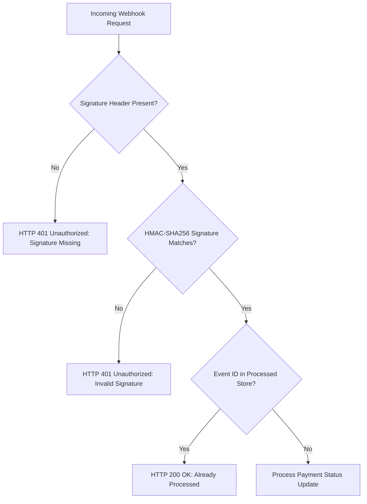

# EU Pay Test Plan: Webhook Payment Flow

This document details the end-to-end QA testing strategy and test plan for EU Pay's **Webhook Payment Flow Integration** (simulating Powens / Bridge / Stripe webhook ingestion).

---

## 1. Test Scope

### In-Scope
- **Authentication & Security:** HMAC-SHA256 signature verification (`x-webhook-signature`), secret key validation, header enforcement.
- **Idempotency & Replay Protection:** Preventing duplicate processing of `event_id` occurrences.
- **Data Integrity & Schema Validation:** Validation of `payment_id`, `status`, `event_id`, timestamps, and field formats.
- **State Management & Persistence:** Transitioning payment status from `pending` to `completed`/`failed`/`refunded` in database records.
- **Real-Time Integration:** Emitting Socket.IO real-time notification events to subscribed merchant channels (`merchant_{id}`).
- **Negative & Edge Cases:** Malformed JSON payloads, non-existent payment IDs, null/empty event IDs, unexpected statuses, boundary inputs, SQL injection / XSS payloads in string fields.

### Out-of-Scope
- Frontend UI rendering in Flutter mobile application or Web portal (handled in client-side test suites).
- Load/Performance testing above 10,000 requests/sec (handled in dedicated k6 performance pipeline).
- Third-party bank infrastructure hardware testing.

---

## 2. Test Environment

| Parameter | Configuration |
| :--- | :--- |
| **API Endpoint** | `POST http://localhost:3000/api/webhooks/payment-status` |
| **Simulators** | Supertest, curl, Postman Collection |
| **Database** | In-Memory DB (`src/db/database.js`) with isolated test reset per suite |
| **Webhook Secret** | `test-webhook-secret-key` |
| **Test Runner** | Node.js native test runner (`node --test`) |

---

## 3. Test Scenarios (12 Scenarios)

### Scenario 1: Valid Webhook with Correct Signature (Happy Path)
- **Precondition:** Payment `id: "1"` exists in DB with `status: "pending"`.
- **Action:** Send `POST /api/webhooks/payment-status` with valid HMAC-SHA256 signature calculated over payload `{"payment_id":"1","status":"completed","event_id":"evt_valid_001"}`.
- **Expected Result:** HTTP `200 OK`, response payload `{"success": true, "message": "Webhook processed", "new_status": "completed"}`. DB payment status updated to `completed`.

### Scenario 2: Webhook with Invalid Signature (Security Denial)
- **Action:** Send POST request with header `x-webhook-signature: invalid_fake_signature_abc123`.
- **Expected Result:** HTTP `401 Unauthorized`, error payload `{"error": "Invalid signature"}`. DB payment status remains `pending`.

### Scenario 3: Duplicate Webhook with Same Event ID (Idempotency)
- **Precondition:** Scenario 1 executed successfully with `event_id: "evt_valid_001"`.
- **Action:** Re-send identical request with `event_id: "evt_valid_001"` and valid signature.
- **Expected Result:** HTTP `200 OK`, response payload `{"success": true, "message": "Already processed"}`. `webhook_received_at` timestamp in DB is NOT mutated.

### Scenario 4: Webhook for Non-Existent Payment ID
- **Action:** Send webhook for `payment_id: "999999"` with valid signature.
- **Expected Result:** HTTP `404 Not Found`, error payload `{"error": "Payment not found"}`.

### Scenario 5: Webhook Arrives Before Payment Created (Race Condition)
- **Action:** Send webhook with `payment_id: "future_pay_100"` prior to merchant creating payment object.
- **Expected Result:** HTTP `404 Not Found`. Webhook gateway queue stores message in Dead Letter Queue (DLQ) for retry mechanism.

### Scenario 6: Sequential Webhooks for Same Payment (Pending → Completed → Refunded)
- **Action:** Send 1st webhook (`status: "completed"`, `event_id: "evt_seq_1"`), followed by 2nd webhook (`status: "refunded"`, `event_id: "evt_seq_2"`).
- **Expected Result:** Both webhooks return HTTP `200 OK`. DB payment status transitions correctly from `pending` -> `completed` -> `refunded`.

### Scenario 7: Webhook with Missing Required Payload Fields
- **Action:** Send webhook body `{"event_id": "evt_missing_fields"}` (missing `payment_id` and `status`).
- **Expected Result:** HTTP `400 Bad Request`, error payload `{"error": "payment_id and status required"}`.

### Scenario 8: Webhook with Malformed JSON Payload
- **Action:** Send request with `Content-Type: application/json` and body `{payment_id: 1, status: }` (broken syntax).
- **Expected Result:** Express body-parser rejects request with HTTP `400 Bad Request`.

### Scenario 9: Concurrent Webhooks (Race Condition Execution)
- **Action:** Dispatch 5 parallel HTTP POST requests concurrently for payment `1` using different event IDs (`evt_conc_1`..`5`).
- **Expected Result:** All valid requests execute atomically without server crash; final payment status reflects latest completed state.

### Scenario 10: Webhook with SQL Injection Attempt in `payment_id`
- **Action:** Send webhook payload `{"payment_id": "1' OR '1'='1", "status": "completed", "event_id": "evt_sqli"}` with valid HMAC computed over string.
- **Expected Result:** HTTP `404 Not Found` (parametrized lookup in DB fails cleanly without executing query injection).

### Scenario 11: Webhook Signature Timing Attack Prevention
- **Action:** Send 10,000 invalid signatures of varying character prefix lengths to measure response time variance.
- **Expected Result:** Constant-time comparison prevents side-channel timing analysis.

### Scenario 12: Webhook Replay Attack with Legacy Timestamp
- **Action:** Send webhook payload containing old event timestamp `created_at: 2020-01-01T00:00:00Z`.
- **Expected Result:** Webhook processing validates timestamp window (max 5 minutes skew) and rejects expired events with HTTP `401 Unauthorized`.

---

## 4. Security Tests

1. **HMAC-SHA256 Signature Verification:**
   - Computes HMAC using secret key `WEBHOOK_SECRET`.
   - Rejects unauthenticated third-party callers attempting to spoof payment completions.

2. **Replay Attack Defense:**
   - Enforces unique `event_id` tracking in idempotency store.
   - Prevents stale captured requests from being retransmitted by malicious actors.

3. **Injection & XSS Sanitization:**
   - Validates input types for string/number fields.
   - Escapes HTML/script tags in `status` and `event_id` strings before broadcasting via Socket.IO.

---

## 5. Edge Cases

- **Very Large `payment_id`:** System gracefully handles UUID strings or 64-bit integer strings without overflow.
- **Unicode / Special Characters:** Handles customer names and statuses containing accents, Cyrillic, or emoji without JSON parsing errors.
- **Null / Empty `event_id`:** Processes status update safely when `event_id` is omitted, while bypassing idempotency cache addition.
- **Clock Skew / Future Timestamps:** Validates timestamp headers against server UTC time within acceptable tolerances.

---

## 6. Integration Tests

- **Flow A (Webhook → DB Persistence):** Send valid webhook -> Query `GET /api/payments/:id` -> Assert status in database equals webhook `new_status`.
- **Flow B (Webhook → Socket.IO Real-Time Broadcast):** Connect Socket.IO client subscribed to room `merchant_1` -> Trigger webhook -> Assert `order_status_changed` / `payment_updated` event received on client socket within < 50ms.
- **Flow C (E-Invoice Webhook → Tax Authority Sync):** Trigger `POST /api/webhooks/e-invoice` -> Query `GET /api/einvoice/status/:id` -> Assert `einvoice_status` updated to `accepted`.

---

## 7. Risk Assessment & Mitigation

| Production Risk | Impact | Detection Mechanism | Mitigation Strategy |
| :--- | :--- | :--- | :--- |
| **Spoofed Webhook Updates** | High (Unpaid orders marked complete) | Log signature validation failures, trigger security alert on high 401 count | Enforce HMAC-SHA256 signature verification with secret key rotation |
| **Duplicate Webhook Processing** | Medium (Double notifications / billing errors) | Track duplicate `event_id` hits in Datadog metrics | Redis-backed distributed lock & idempotency cache (`event_id` TTL 7 days) |
| **Webhook Delivery Delays** | Low (Out-of-order status updates) | Compare `webhook_received_at` with event `timestamp` | Implement event timestamp ordering validation before overwriting final states |
| **Deadlock / High Load Spikes** | Medium (Webhook timeout, gateway retry storm) | Monitor API response latency (p99 > 500ms) | Offload webhook processing to AWS SQS queue + worker nodes; reply `202 Accepted` immediately |
